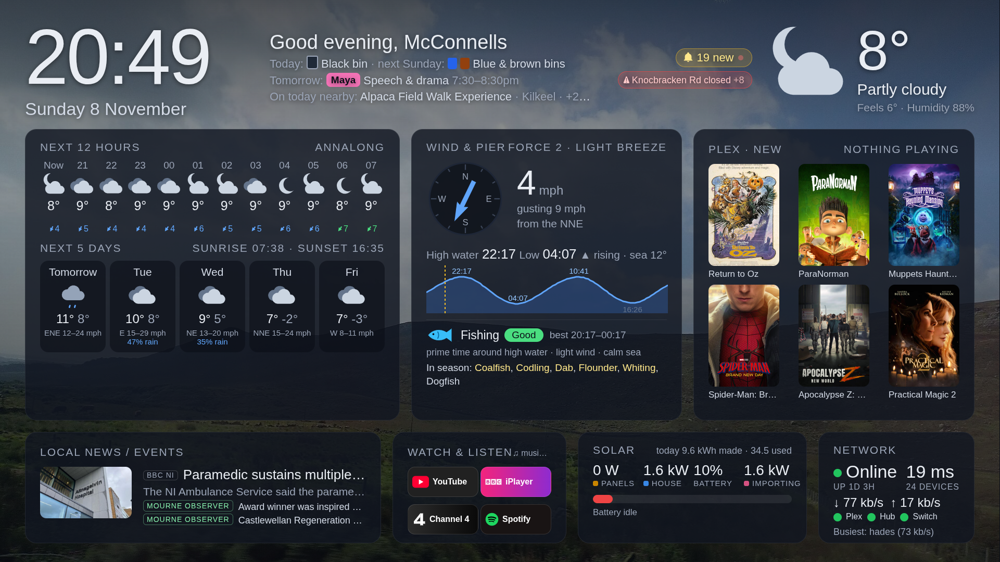

# homedash



A family dashboard for the living-room TV, with a phone view too. It shows the clock, weather, tides,
local news and events, the school newsletter, bin day, clubs, birthdays, solar, the home network, Plex
and travel alerts on one screen, with rotating landscape backgrounds. You drive it with the TV remote:
the arrow keys move around and OK opens things.

It runs as one small Python server with no framework, in Docker on any always-on box on your network.
The TV loads it in a tiny Samsung Tizen app (or any browser). Phones get their own layout from the
same address.

## Features

| Widget | What it shows | Needs |
|---|---|---|
| **Weather** | Next 12 hours, next 5 days, sunrise and sunset, severe-weather warnings | [Open-Meteo](https://open-meteo.com) (no key), optional Met Office warnings RSS |
| **Marine** | Tide times and curve, a "worth going to the pier?" verdict, fish in season | Open-Meteo marine model, `[marine]` lat/lon |
| **Plex** | Now playing and recently added; OK opens the Plex app | `PLEX_TOKEN` |
| **News** | Tabbed RSS feeds and a "local news / events" card, with a built-in article and PDF reader | `[[news.feeds]]` |
| **Events** | "On today nearby" in the header, plus an events tab | Eventbrite, Discover NI, Visit MGS, Facebook via RSS (any of these) |
| **School** | Newsletters as a news tab; dated reminders from the newsletter PDFs go on the calendar | `[school]` (swd-platform school sites) |
| **Bins / clubs / birthdays** | "Today: black bin", a weekly clubs calendar, birthday countdowns | `[bins]`, `[[clubs.weekly]]`, `[[family]]` |
| **Solar** | Live PV, battery, grid and house power, today's totals, a history chart | SolaX Cloud developer credentials |
| **Network** | Online status, up/down throughput, latency to your services, a live per-device view, Pi-hole stats | `[[network.services]]`; optional EE Smart Hub and Pi-hole |
| **Alerts** | Roadworks and incidents on your routes, nearby power cuts | `[alerts] provider = "ni"` (Northern Ireland) |
| **Notes** | Short messages pinned to the TV and phone (e.g. from a chat bot) | `HOMEDASH_TOKEN` |
| **Watch & listen** | App tiles that launch TV apps; internet radio | `[[apps]]`, `[[radio]]` |
| **Backgrounds** | Landscape photos from a Wikimedia Commons category, credited on screen, plus your own photos | `[backgrounds]`, `data/photos/` |

A widget hides itself when what it needs is missing, so if you don't have solar you won't see a solar
card. You can also turn any widget off in `[widgets]`. The layout reflows to fill the space.

## Quick start

```sh
git clone <this repo> homedash && cd homedash
cp config.example.toml config.toml   # edit: household, location, feeds, family...
cp .env.example .env && chmod 600 .env   # add only the secrets you need
mkdir -p data
docker compose up -d --build
```

Then open `http://<server-ip>:8090/` in a browser.

- `/tv` forces the TV layout and `/m` forces the phone layout. Phones get the phone layout
  automatically.
- On a TV browser, the arrow keys move around, OK opens things, and Back or Escape closes them.

The container uses host networking so it can reach Plex and Pi-hole on `127.0.0.1` and devices on the
LAN. It writes caches, history, notes and photos to `./data`.

## Configuration

- **`config.toml`** holds everything about your household and region: location, feeds, family, clubs,
  routes, apps and radio. [`config.example.toml`](config.example.toml) documents every section. Any
  key you leave out falls back to the defaults in [`server/config.py`](server/config.py). Restart the
  container after you edit it: `docker compose restart`.
- **`.env`** holds secrets only. See [`.env.example`](.env.example). Both files are git-ignored.

| Secret | Used for |
|---|---|
| `PLEX_TOKEN` | Plex now-playing and recently added (the `PlexOnlineToken` in the server's `Preferences.xml`) |
| `SOLAX_CLIENT_ID`, `SOLAX_CLIENT_SECRET` | An application on the [SolaX Developer Portal](https://developer.solaxcloud.com) |
| `EE_HUB_PASSWORD` | Router stats from an EE Smart Hub Pro (`[network] router = "ee_smarthub"`) |
| `PIHOLE_PASSWORD` | Pi-hole v6 stats on the network page |
| `HOMEDASH_TOKEN` | Lets tools post notes (`POST /api/notices` with header `X-Homedash-Token`) |

Region-specific sources:

- Met Office warnings, Discover NI, Visit Mourne Gullion & Strangford, TrafficWatchNI and NIE
  PowerCheck are UK or Northern Ireland sources.
- Elsewhere, leave those sections out and the related widgets hide themselves.
- Open-Meteo, RSS, Eventbrite and Wikimedia Commons work anywhere.

## TV app (Samsung Tizen)

`tizen/` is a minimal Tizen web app. It shows the dashboard full screen and lets the dashboard launch
other TV apps such as YouTube and iPlayer from its tiles.

1. Install [Tizen Studio](https://developer.tizen.org/development/tizen-studio/download) (the CLI is
   enough). Then create a security profile in the Certificate Manager or with
   `tizen certificate` / `tizen security-profiles add`.
   - Newer TVs need a **Samsung** certificate tied to the TV's DUID.
   - Older TVs (for example 2017 models) reject Samsung certificates with `install failed[118]`. For
     those, use a plain **Tizen** author certificate instead.
2. On the TV, turn on Developer Mode:
   - Open Apps, then press `1 2 3 4 5` on the remote.
   - Turn Developer Mode on and enter your computer's IP address.
   - Restart the TV.
3. Build and install:

   ```sh
   cd tizen
   ./build.sh --install <tv-ip> --profile <your-profile>
   # the dashboard URL comes from [tv] dashboard_url in config.toml, or pass it as the first argument
   ```

The app keeps no data of its own. Changes to the dashboard show up the next time it reloads, so you
only rebuild the app if the dashboard URL changes.

**Other TVs:**

- Any TV with a modern browser can open `http://<server-ip>:8090/tv` and bookmark it. That includes
  Hisense VIDAA, LG webOS and Android or Google TV.
- In a plain browser, the app tiles can't launch other apps.

## Helper tools

- **`tools/hub-posters`** reads a Facebook page through its RSS feed. It asks Claude
  (`claude -p`, with the Read tool only) to transcribe dated activities from event posters, and writes
  them to `data/hub_events.json`, which the dashboard merges into its events list. It uses the first
  `[[events.facebook_feeds]]` entry with `posters = true`. Run it every few hours from a systemd user
  timer or cron on the server.
- **Notes**: anything that can make an HTTP request can pin a note:

  ```sh
  curl -X POST http://<server-ip>:8090/api/notices -H "X-Homedash-Token: $HOMEDASH_TOKEN" \
       -H "Content-Type: application/json" -d '{"text":"Dinner at 7", "hours": 6, "by": "Mum"}'
  ```

  To remove a note, send `DELETE /api/notices/<id>`, or `/api/notices/all` to clear them all.

## How it works

```
server/
  app.py          HTTP server, background collectors (one thread each, @every(seconds)), /api/state
  config.py       config.toml + defaults, secrets from env, effective widget switches
  alerts.py       road incidents along routes, power faults (NI)
  backgrounds.py  Wikimedia Commons crawl + your own photos
  dni.py vmgs.py  regional what's-on sources
  marine.py       tides from modelled sea level, pier verdict, fish in season
  school.py pdfpages.py reader.py   school newsletters, PDF page rendering, article reader
  solax.py pihole.py usp.py         solar, Pi-hole, EE Smart Hub (USP over MQTT)
  static/         TV page (index.html, app.js, style.css: ES5 for older TV browsers)
                  phone page (mobile.html, mobile.js, mobile.css)
tizen/            TV app shell
tools/            hub-posters
```

How the pieces fit together:

- Collectors refresh their slice of state on their own schedules.
- The pages poll `/api/state` and `/api/config`, the non-secret part of the config including which
  widgets are on.
- Radio streams, Plex artwork and news images are proxied through the server, so the TV only ever
  talks to one local HTTP origin.

## Data sources and attribution

- Weather and marine data: [Open-Meteo](https://open-meteo.com) (CC BY 4.0). Tides come from a model,
  so expect them to differ from official tide tables by about ±20 minutes. Don't use them for
  navigation.
- Warnings: Met Office (Open Government Licence).
- Background photos: [Wikimedia Commons](https://commons.wikimedia.org). Each photo's author and
  licence are shown on screen.
- Travel and power: TrafficWatchNI, NIE Networks PowerCheck.
- News and events: the feeds and sites you configure. Headlines link back to the source.

Be gentle with the sources: collectors poll at modest intervals and cache to disk.

## Privacy

- `config.toml`, `.env` and `data/` hold your household's details. They are git-ignored, so keep them
  out of any fork.
- The dashboard has no login and is meant for your home network only. Don't expose port 8090 to the
  internet.
